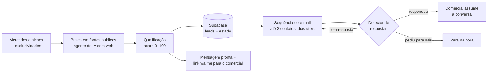

# Máquina de Prospecção

**Prospecção B2B com IA para agências.** A Máquina encontra empresas do perfil certo em fontes públicas, qualifica cada uma com um score objetivo e abre a conversa pelo canal mais adequado para cada empresa, com uma abordagem curta, personalizada e respeitosa. Quando a empresa responde, a conversa passa para o comercial humano. Ela abre a porta; quem conduz e fecha a venda é o comercial.

Desenvolvida para a agência **Roteirizow** (Fortaleza/CE). A demanda surgiu depois que a agência perdeu 4 clientes numa mesma semana e percebeu que o comercial dependia só de indicação.

`n8n` · `Claude API` · `Supabase / PostgreSQL` · `Gmail API (OAuth)` · `Google Maps/Places` · `JavaScript`

---

## O problema

O comercial da agência sabe fechar negócio. O gargalo está **antes** disso: não existe um fluxo constante de empresas qualificadas para conversar. Prospecção manual não escala, e as alternativas comuns trazem risco:

- **Lista comprada:** dado ruim e problema com a LGPD.
- **Disparo em massa:** o domínio cai no spam, inclusive os e-mails normais da agência.
- **Automação no WhatsApp:** o número é banido.

## A solução



1. **Definição com a agência:** quais mercados podem ser prospectados, quais nichos ficam de fora por exclusividade com clientes atuais, região e porte ([modelo](modelos/mercados-e-nichos.csv)).
2. **Busca:** um agente de IA com acesso à web encontra empresas reais do nicho e verifica cada contato numa fonte (site, Google Maps, redes oficiais). **Nenhum dado é inventado:** o que não foi verificado fica `null` ([prompt](prompts/caca-e-qualificacao-de-leads.md)).
3. **Qualificação ("Temperatura de Entrada"):** score de 0 a 100 em quatro dimensões: aderência do mercado (25), fit de perfil (25), sinais reais de dor de captação com decaimento por recência (30) e qualidade do contato (20). O score **prioriza, nunca exclui** ([`qualificacao.js`](src/qualificacao.js)).
4. **Abordagem:**
   - **E-mail:** até 3 contatos (apresentação; retomada 3 dias úteis depois; encerramento educado no 7º dia útil), com aquecimento gradual do remetente ([`sequencia.js`](src/sequencia.js), [`aquecimento.js`](src/aquecimento.js)).
   - **WhatsApp:** sem automação. A Máquina gera a mensagem e o link `wa.me`, e o comercial envia do próprio celular ([`whatsapp.js`](src/whatsapp.js)).
5. **Detector de respostas:** lê a caixa do comercial@, reconhece respostas pelo endereço ou pelo domínio corporativo, ignora respostas automáticas (férias, ausência), trata pedidos de descadastro e **interrompe a sequência na hora**.

## Decisões de produto

- **Primeira entrega sem depender do e-mail.** Aquecer um domínio leva semanas. Por isso a primeira entrega foi uma lista verificada do nicho prioritário, com uma mensagem pronta por empresa para o comercial usar por WhatsApp, Instagram ou ligação.
- **Uma oferta por nicho.** Médico, advogado e construtora têm dores e regras diferentes (CFM, Provimento 205/2021 da OAB). A mensagem fala da dor específica do nicho. O preço nunca entra no texto.
- **Volume calibrado pelo lado humano.** O teto de envios é definido pela capacidade do comercial de atender bem (sugestão inicial: até 5 conversas novas por semana), não pela capacidade da ferramenta.
- **Entregabilidade antes de volume:** e-mail no domínio da agência, SPF, DKIM e DMARC, OAuth em vez de senha, e aquecimento de 5 a 30 e-mails por dia ([detalhes](docs/entregabilidade-e-pre-requisitos.md)).

## Status atual

| Frente | Situação |
|---|---|
| Arquitetura e regras de envio | Prontas: sequência, aquecimento, qualificação e WhatsApp com testes |
| Detector de respostas (n8n) | Ativo |
| Follow-up automático (n8n) | Pronto, aguardando a conexão da caixa da agência |
| Pré-requisitos da agência | E-mail comercial criado; DMARC, OAuth, nichos e ofertas em definição com o comercial |
| Envios | **Ainda não começaram.** Os resultados serão publicados com dados reais |

Este repositório mostra o desenho e as regras da Máquina. Não há resultado de conversão para mostrar ainda, e prefiro deixar isso claro a projetar números.

## Estrutura

```
src/
  qualificacao.js    score "Temperatura de Entrada" (0–100) e priorização
  sequencia.js       sequência de 3 contatos em dias úteis + detector de respostas e opt-out
  aquecimento.js     teto diário de envios e simulação semana a semana
  whatsapp.js        normalização de telefone BR e link wa.me
test/                testes com node:test, sem dependências
prompts/             prompt do agente de busca e qualificação
modelos/             planilha de mercados, nichos e exclusividades
docs/                entregabilidade, pré-requisitos e simulação do aquecimento
```

## Como rodar

Requer Node.js 20 ou superior, sem dependências.

```bash
npm test
```

```bash
npm run simular
```

`npm run simular` mostra a tabela de aquecimento: e-mails, follow-ups e empresas novas por semana.

## Projeto relacionado

**[Máquina de Conteúdo](https://github.com/Sk0bbar/maquina-de-conteudo)**: mesma base (n8n + Supabase + Claude), em produção com a mesma agência desde setembro de 2026. As duas juntas formam um pacote para agências: conteúdo para quem já é cliente e prospecção para trazer os próximos.

---

Desenvolvido por **Pablo Vidal** ([Vidal Intelligence](https://github.com/Sk0bbar)).
